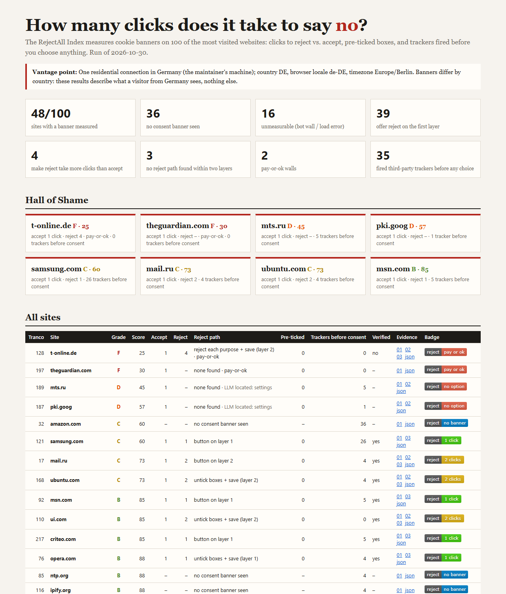

# RejectAll Index

**How many clicks does it take to say no?**

A headless browser visits the 100 most-visited websites and measures what it takes to refuse cookies:

- clicks to "reject all", compared with clicks to "accept all";
- whether reject is only on a second layer;
- pre-ticked toggles, including "legitimate interest";
- third-party trackers that fire **before** any choice is made, read from the network log.

Scoring is deterministic: the same evidence always gives the same score. Every site has screenshots, an `evidence.json` and its full request log.



## Vantage point

> **All results are from one residential connection in Germany** (browser locale `de-DE`, timezone `Europe/Berlin`).

Banners differ by country, and many sites show no banner at all to US visitors. These numbers describe what a visitor from Germany sees, nothing else.

## Results: run of 2026-10-30

Of the 100 sites, 84 could be measured; 16 were not.

| | Sites |
|---|---|
| Showed a consent banner and were measured | 48 |
| Showed no banner | 36 |
| Unmeasurable: bot wall (HTTP 403, challenge frame, "Access Denied", CAPTCHA, 429), timeout or DNS failure | 16 |
| Banner verifiably gone after the reject path | 42 of 48 |
| Reject offered on the first layer | 39 of 48 |
| Reject takes more clicks than accept | 4 |
| No reject path within two layers | 3 |
| Pay-or-ok wall | 2 |
| Fired third-party trackers **before** any choice (banner or not) | 35 |
| LLM fallback consulted / decided a button | 10 / 4 sites (12 calls) |

Grades: A 70, B 6, C 4, D 2, F 2, unmeasurable 16.

**Worst measured:**

| Site | Grade | Why |
|---|---|---|
| t-online.de | F (25) | pay-or-ok, 4 clicks to reject, banner not verifiably gone |
| theguardian.com | F (30) | pay-or-ok |
| mts.ru | D (45) | no reject option, 5 tracker domains before consent |
| pki.goog | D (57) | notice-only "OK, got it" |
| samsung.com | C (60) | 26 tracker domains before consent |

amazon.com showed **no banner** to this vantage point, yet contacted 36 listed advertising and analytics domains before any interaction.

**Run-to-run stability.** The same 100 sites were run three times within about two hours. 6 sites changed status between runs for reasons unrelated to our rules: netflix, intuit and baidu flipped between measured/no-banner and unmeasurable; linkedin, triplinkintl and f5 flipped between banner and no banner. Treat any single site's result as one observation, not a verdict. A full run takes about 21 minutes.

The full table is in [`site/index.html`](site/index.html), the raw data in [`data/latest.json`](data/latest.json) and the per-site evidence in `data/runs/2026-10-30/sites/<domain>/`.

## Usage

```bash
python -m venv .venv && .venv/Scripts/pip install -r requirements.txt && .venv/Scripts/python -m playwright install chromium
python -m rejectall pick            # data/sites.json from the latest Tranco list
python -m rejectall run             # measure; resumable; writes data/runs/<date>/ and data/latest.json
python -m rejectall build           # site/index.html + site/badges/<domain>.svg
python -m rejectall badge bbc.com   # print one badge SVG
python -m pytest -q tests           # fixture banners, rules, scoring, output
```

The badge states one measured fact, for example . Possible values are "reject: N clicks", "no option", "pay or ok", "no banner" and "unmeasurable".

## Methodology

**Sites.** Tranco list [PYK6J](https://tranco-list.eu/list/PYK6J) (created 2026-10-29). Tranco's top ranks are full of infrastructure domains with no homepage (CDNs, DNS, APIs). We walk the list in rank order and keep the first 100 domains whose homepage answers with HTML:

- the status must be 2xx, or 401/403/429/503, since those may be bot walls;
- domains that redirect to another registrable domain are aliases and are dropped.

This reached rank 227. All 127 skipped domains are listed with their reasons in `data/sites.json`.

**Browser.** For each site:

- a fresh headless Chromium context: no cookies, viewport 1366×900, locale de-DE;
- one page load, then a 6s settle;
- a 3s pause between sites.

The only fingerprint change is the user agent: "HeadlessChrome" is replaced by "Chrome". There are no stealth plugins. CAPTCHAs and bot walls are **never** solved or bypassed; those sites are reported as `unmeasurable` with the reason.

**Finding the banner.** A script collects visible clickable elements across the page, open shadow roots and visible iframes. It records which fixed/sticky/dialog overlay each element belongs to.

Buttons are classified by fixed multilingual text rules ([`rejectall/patterns.py`](rejectall/patterns.py)), in this order: pay → reject → save → settings → accept. With that order, "Reject all and subscribe" is a pay wall, "Accept only necessary" is a reject, and "Accept selection" is a save.

The measured banner is the one with the largest on-screen overlay. Any other banners are recorded as `extra_banners`.

**Reject path.** These are tried in order:

1. a reject button on layer 1;
2. pre-ticked boxes on layer 1, unticked, then save;
3. settings, then layer 2: a reject-all button, otherwise each per-purpose "reject" plus save, otherwise untick the pre-ticked toggles plus save.

Every click is counted. After the path, the page is re-scanned. `verified` is true only if the banner is gone and no consent buttons remain.

**LLM fallback.** The LLM is used only to locate buttons the rules could not label, and never to score. The model is a local gemma-4-12b via llama-server. It sees at most 30 button labels and returns roles. Every call is logged in that site's `evidence.json`, with the prompt, answer and latency. The API key is read from the running server's process or `LLAMA_API_KEY` at run time and is never written to disk.

**Trackers.** We use the [Disconnect tracking-protection list](https://github.com/disconnectme/disconnect-tracking-protection), licensed CC BY-NC-SA 4.0. It is fetched at run time and its sha256 is recorded in the run metadata.

The categories counted are Advertising, Analytics, Social, FingerprintingInvasive, FingerprintingGeneral and Cryptomining. A request counts if:

- its registrable domain is in one of those categories;
- it is third-party, by registrable domain and Disconnect entity, so `youtube.com` loading `google.com` is first-party;
- it fires before the first click.

**Score v1.** Start at 100, then subtract:

| Finding | Penalty |
|---|---|
| Each extra click reject needs over accept | −15 (max −45) |
| No reject path within two layers (not applied when the notice says only necessary cookies are used) | −40 |
| Pay-or-ok wall | −30 |
| Each pre-ticked toggle | −5 (max −20) |
| Each tracker domain fired before consent | −3 (max −40) |

Grades: A ≥ 90, B ≥ 75, C ≥ 60, D ≥ 40, F below. Weights live in [`rejectall/scoring.py`](rejectall/scoring.py). `SCORING_VERSION` is bumped whenever a weight changes.

## Limitations

- **One run, one connection, one day.** Banners are A/B tested and change often.
- Only the **largest** banner is measured. Sites showing two banners (bbc.com shows a TCF modal and its own bar) are marked unverified when one is left open.
- Settings are followed **two layers** deep. Legitimate-interest toggles on tabs that were never opened are not counted.
- "No banner" is not proof that no consent is needed. Some sites decide by IP or show the banner only after scrolling.
- The tracker list is a list. Trackers it does not know are not counted, and some listed domains also serve non-tracking content.
- Text rules miss phrasings they don't know. Those cases fall to the LLM fallback or to `none_found`, and the screenshots show which.

## Daily run

[`.github/workflows/daily.yml`](.github/workflows/daily.yml) is written but **not enabled**: every job is skipped unless the repository variable `REJECTALL_ENABLED` is `true`.

It targets a self-hosted runner labelled `germany`. GitHub-hosted runners would silently move the vantage point to the US.

## Legal

This project publishes measured facts about public web pages, with the raw evidence for each. It does not log in, solve CAPTCHAs or bypass access controls.

## License

- **Code:** [Apache-2.0](LICENSE).
- **Data** (`data/`, `site/`, `docs/`): [CC BY 4.0](DATA_LICENSE). Credit "rejectall-index by dadwritestech" with a link.
- Screenshots of third-party sites show their banners as measured; the sites' content belongs to them.
